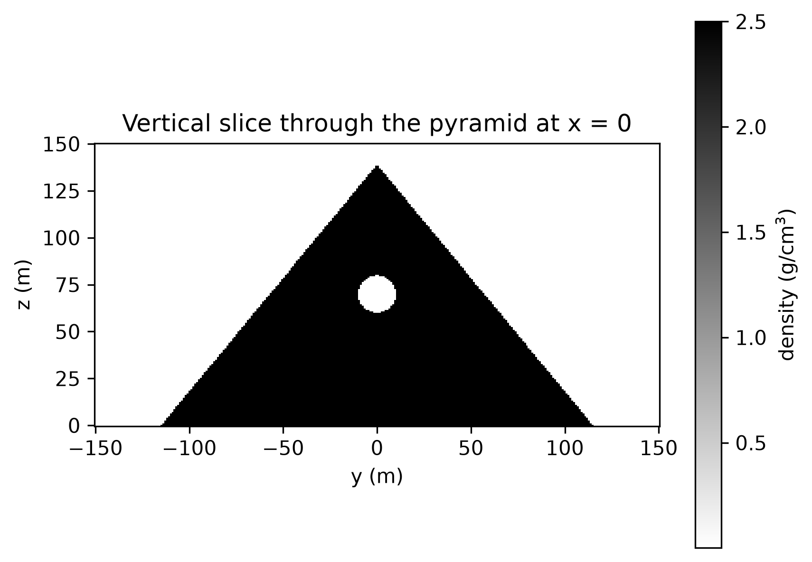
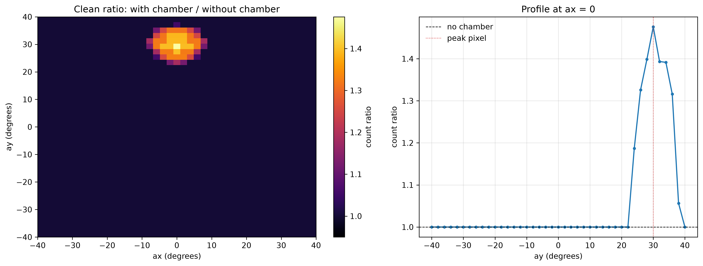
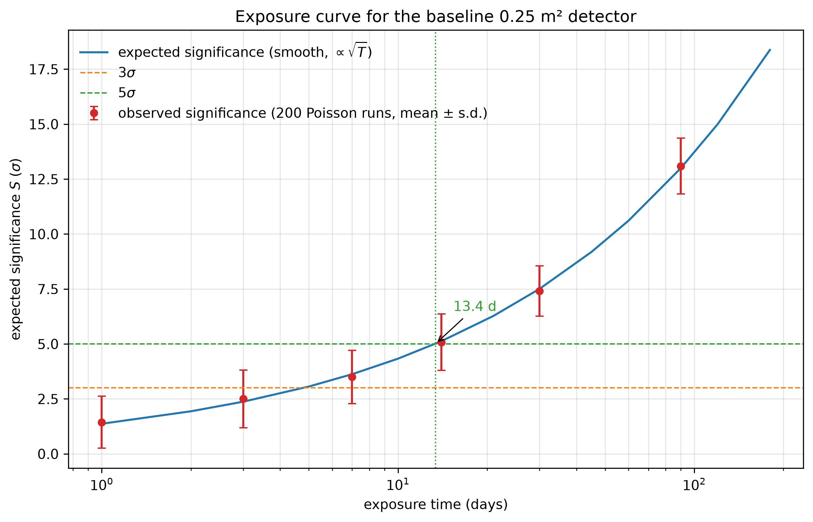

# Seeing Through Solid Rock — Explained for Everyone

**MYSSP Project P-1 · Evan Lim Hong Yan**
*Finding a hidden chamber with cosmic-ray muons*

---

## The one-paragraph version

Every minute, about ten thousand invisible particles called **muons** pass
through every square metre of the ground, including the ground under you. They
are produced when cosmic rays hit the top of the atmosphere, they travel at
almost the speed of light, and they are heavy enough to punch through hundreds
of metres of rock. If you put a detector next to a mountain and count how many
muons come out, the directions with **more** muons are the directions with
**less rock** in the way. That is **muography**: using muons instead of X-rays
to see inside something solid. This project builds a complete computer
simulation of that idea for a pyramid with a hidden chamber, and answers one
question with a number: **how long would a 0.25 m² detector have to run before
the chamber signal reaches the 5σ benchmark?** The answer for the baseline
model is **about 13.4 days**.

---

## 1. A particle that falls on you for free

A cosmic ray is a high-energy particle, usually a proton, that has been
accelerated somewhere in the galaxy. When it hits the upper atmosphere, about
15 km above the ground, it smashes into a nucleus and creates a shower of
shorter-lived particles. Some of those are pions, and pions decay into **muons**.

A muon is best thought of as a heavy electron: same electric charge, no known
internal structure, but about 207 times the electron's mass. It is unstable and
decays in about 2.2 microseconds if it is at rest. That sounds far too short to
reach the ground from 15 km up. Yet muons arrive in enormous numbers, because
they move so close to the speed of light that their internal clock runs slowly.
This is special relativity in action, and cosmic-ray muons are one of the most
direct everyday demonstrations of it.

The number to remember is:

> **About 10,000 muons pass through every square metre of ground every minute.**

Most arrive from roughly overhead, and the number falls off as you look toward
the horizon. The flux above 1 GeV straight up is about 60 muons per square
metre per second per steradian. That is an unusual unit; a **steradian** is a
unit of solid angle, the three-dimensional cousin of a radian. The whole sky
above you is 2π steradians, so a flux of 60 per m² per second per steradian
means roughly 60 muons per square metre per second in a one-steradian patch of
sky.

Muons also cover a huge range of energies. Most have a few GeV; a small fraction
have hundreds of GeV; a very few have more than 10,000 GeV. That rare
high-energy tail is the part that matters, because only the most energetic
muons can cross a hundred metres of rock.

---

## 2. Why muons can see through rock

As a charged particle moves through matter, it loses energy by knocking
electrons out of atoms. The loss rate is about **2 MeV for every gram per square
centimetre** of material it crosses. That unit — grams per square centimetre —
is called **opacity**, and it is a clever way of measuring “how much stuff” that
does not care what the stuff is. One metre of limestone with density
2.5 g/cm³ has an opacity of

$$
2.5\ \mathrm{g/cm^3} \times 100\ \mathrm{cm} = 250\ \mathrm{g/cm^2}.
$$

Crossing that costs a muon about 0.5 GeV. Crossing 100 m costs about 50 GeV,
which is more than ten times the energy of a typical cosmic muon. Only the rare
high-energy tail gets through.

Why muons and not electrons? An electron is light, so when it is deflected by a
nucleus it radiates energy away very efficiently. A muon is 207 times heavier,
and the radiation rate is suppressed by roughly $207^2 \approx 43{,}000$. It
therefore loses energy slowly and keeps going. Protons and alpha particles are
also heavy, but they feel the strong nuclear force and are absorbed much sooner.
The muon is the Goldilocks particle for imaging: heavy enough to penetrate,
weakly interacting enough to survive, and plentiful enough to measure.

A useful exact formula for the **minimum energy** a muon needs to survive an
opacity $X$ is

$$
E_{\min}(X) = \frac{a}{b}\left(e^{bX}-1\right),
$$

with $a \approx 2.0\times10^{-3}$ GeV per g/cm² and
$b \approx 4.0\times10^{-6}$ per g/cm². The $a$ term is ordinary ionisation; the
$bE$ term is radiation and only matters at very high energy. For small $X$ the
formula reduces to the simple rule $E_{\min} \approx aX$. At 100 m of limestone
($X = 25{,}000$ g/cm²) the exact value is 52.6 GeV, about 5 per cent higher than
the simple 50 GeV estimate. That 5 per cent is the radiative term, not a bug.

---

## 3. The experiment we simulated

Nobody in this project touches a real detector. Everything happens in Python.
The simulation has five steps, and each one is a separate notebook.

**The target.** A square-based pyramid 230 m along the base and 139 m tall,
made of limestone with density 2.5 g/cm³. Inside it, at height 70 m, is a
spherical chamber of radius 10 m (20 m across) filled with air. The detector is
a 0.25 m² square at position `(0, −40, 3)` m, looking upward with a ±40° field
of view. The image is divided into 2° × 2° pixels, so there are 41 × 41 = 1,681
directions.

**The question.** Under this model, how many days of exposure does the detector
need before the **expected** chamber signal reaches **5σ**?

The word “expected” is important. It means the average signal the model predicts,
not the result of one noisy measurement. A real measurement will fluctuate
around that average, just as 100 coin tosses do not always give exactly 50
heads.

---

## 4. Step 1: build a fake pyramid with a secret

The first job is to describe the target as a function of position: give the
computer any point $(x, y, z)$ and it returns the density at that point. Outside
the pyramid the density is air (0.0012 g/cm³), inside the rock it is
2.5 g/cm³, and inside the chamber it is air again.

The chamber is the secret. It sits at `(0, 0, 70)` m and is 10 m in radius.
Everything else about the target is boring and predictable — which is exactly
the point, because the interesting part of the eventual image is the difference
between “what we expected” and “what we saw.”

A vertical slice through the pyramid is shown in
`figures/05_density_slice.png`. It looks like a triangle with a small circular
hole. That picture is the “before” image: the truth, drawn by us, with the
chamber visible because we put it there.



---

## 5. Step 2: shoot rays and measure “how much rock”

For every one of the 1,681 viewing directions, the computer walks a ray from
the detector through the target in 0.25 m steps. At each step it asks the target
for the density, multiplies by the step length, and adds it up. The result is
the **opacity** along that line, in g/cm². This process is called **ray
marching**.

The physics does not enter yet. This step is pure geometry: “how much material
would a muon travelling along this exact line have to cross?” The answer is
large where the pyramid is thick, smaller where the line passes through the
chamber, and small where the ray leaves the target quickly.

The map of opacity versus direction is the first real image. It already shows
the chamber as a notch: `figures/06_opacity_notch.png` shows the opacity falling
by about 5,000 g/cm² as the line of sight sweeps across the chamber. That number
is easy to understand: the ray is missing a chord through a sphere, and the
longest chord is the diameter, 20 m. The missing opacity is therefore

$$
2r\rho \times 100 = 2(10)(2.5)(100) = 5{,}000\ \mathrm{g/cm^2}.
$$

The measured value is 4,935 g/cm², about 1.3 per cent lower because the discrete
ray does not pass exactly through the centre. That agreement is the first
validation of the geometry.

---

## 6. Step 3: turn rock into muon counts

From the opacity of each direction we calculate the minimum energy a muon needs
to survive, and then count how many muons in the cosmic-ray spectrum have at
least that energy. The flux is multiplied by the detector area, the solid angle
of one pixel, and the exposure time:

$$
N = \Phi(E_{\min}, \theta)\,A\,\Omega\,T .
$$

The pixel solid angle is approximated as $\Omega = (\Delta\theta)^2$ with
$\Delta\theta = 2° = 0.0349$ rad. For the baseline detector, one pixel collects
anywhere from about 6 to 40 muons per day, depending on direction. The whole
1,681-pixel image collects about 33,000 muons per day. That sounds like a lot
until you remember it is spread over 1,681 pixels, and each pixel only gets a
few dozen.

The expected-count map for 30 days (`figures/08_expected_counts.png`) is a
picture of the **pyramid**, not the chamber. The thickest direction has about
six times as many muons as the thinnest. The chamber changes one pixel by about
48 per cent. A 48 per cent effect hidden under a factor-six gradient is
invisible to the eye, which is exactly why the next step is necessary.

---

## 7. Step 4: make a picture — the before-and-after pair

The trick is to build a **twin target** with the chamber filled back in with
solid rock, run the same calculation, and divide the two maps pixel by pixel:

$$
\mathrm{ratio} = \frac{\text{expected counts with chamber}}
                       {\text{expected counts with chamber filled solid}} .
$$

Away from the chamber the ratio is 1.000: the pyramid's shape cancels out of the
numerator and denominator. At the chamber it rises to about **1.48**, because
the missing rock lets roughly half as many extra muons through. The ratio map
(`figures/09_clean_ratio.png`) is the “after” image. It is the first picture in
which the chamber is actually visible from the muon data alone.

This is a **muon radiograph**, not a full three-dimensional CT scan. One viewing
direction becomes one pixel, exactly as in the original 1970 Alvarez pyramid
experiment and the 2017 ScanPyramids images. Turning many overlapping views into
a 3D density model is a harder, separate problem.




---

## 8. Step 5: add noise and ask “is it real?”

Nature does not deliver exactly the expected number of muons. It delivers a
random number drawn from a **Poisson distribution** whose average is the
expected number. If the average is $N$, the typical spread is about $\sqrt{N}$.
For 100 counts the spread is 10 (10 per cent); for 10,000 counts it is 100
(1 per cent). This is why one day of data is almost pure noise, and why the
project needs many days.

The **observed significance** of a measurement is

$$
S = \frac{N_{\text{observed}} - N_{\text{expected without chamber}}}
         {\sqrt{N_{\text{expected without chamber}}}} .
$$

It answers: “how many standard deviations above the no-chamber expectation is
this count?” A 3σ fluctuation happens about once in 750 tries; a 5σ fluctuation
about once in 3.5 million. Those are conventional thresholds, not magic.

But there is a trap. The image has 1,681 pixels. If each pixel has a 1-in-750
chance of reaching 3σ by luck, then a completely solid pyramid with no chamber
should produce about two or three 3σ pixels in every image. This is the
**look-elsewhere effect**. In 500 noise-only simulations, the largest pixel had
a median of about 3.4σ and exceeded 3σ in 92 per cent of images. None reached
5σ, but the lesson is clear: a single surprising pixel is not a discovery.

For the official result the project therefore uses the **expected
significance**:

$$
S_{\text{expected}} =
\frac{\mu_{\text{with chamber}} - \mu_{\text{without chamber}}}
     {\sqrt{\mu_{\text{without chamber}}}} ,
$$

computed from the noiseless expectation maps, at **one fixed signal pixel**
chosen once from the baseline model. That curve is smooth and reproducible. A
real noisy measurement jitters around it, but the curve, not the jitter, defines
the headline exposure time.

Because both the signal and the background grow linearly with exposure time
$T$, the expected significance grows as $\sqrt{T}$. Doubling the exposure
multiplies the significance by only 1.41; reaching 5σ from 3σ requires
$(5/3)^2 \approx 2.8$ times more time.

---

## 9. The headline answer

The fixed signal pixel is at `ax = 0°`, `ay = 30°`, the line of sight from the
detector to the chamber centre. At 30 days its expected significance is
**7.50σ**. Scaling as $\sqrt{T}$ gives:

- **3σ at about 4.8 days**;
- **5σ at about 13.4 days** (13.33 days from the exact square-root scaling,
  13.37 days from linear interpolation between scan points).

So the headline sentence is:

> **For the baseline 0.25 m² detector and a 10 m radius chamber, the expected
> chamber signal reaches 5σ after approximately 13.4 days under the project's
> simplified model.**

This is a property of the model, not a measurement, so it has no statistical
uncertainty. A real 30-day observation would land near 7.5σ but fluctuate by
about ±1.2σ. At 14 days, about half of the simulated experiments cross 5σ even
though the expected value is 5.1σ. That is what “expected” means.

The number also depends on the definition of significance. If instead of one
pixel we ask for the significance of the **whole image**, the 30-day value is
only about 3.55σ, and the 5σ exposure is about **59 days**. The per-pixel
definition is the project's official benchmark; the whole-image number is the
more conservative global statement. Both are reported.



---

## 10. What changes the answer? The four studies

The project requires two parameter studies; this project does all four, plus
several extras.

**Study A — chamber size.** A chamber of radius 4 m needs about 147 days; a
20 m chamber needs about 2 days. The significance grows roughly as $r^{1.3}$,
not as the volume $r^3$. A muon radiograph measures the **chord length** through
the chamber, which grows like $r$, not the volume. This is the most important
geometric lesson of the project.

**Study B — chamber depth.** Moving the chamber from 55 m to 110 m changes the
required exposure from about 15 to 22 days, with a broad optimum near the
field-of-view edge and a secondary rise near the apex. Two effects compete:
a shallower chamber is reached through less rock but at a larger zenith angle
where the muon flux is lower; a deeper chamber is reached through more rock but
closer to the vertical. The rise above 95 m is a pyramid-geometry effect: the
ray exits the rock soon after the chamber, so the total overburden stops
growing.

**Study C — detector placement.** Moving the detector closer along the symmetry
axis has a clear optimum near `y = −25` m, where the exposure is about 16 days,
compared with 17.3 days at the baseline `y = −40` m and 21.7 days at
`y = −55` m. Moving too close increases the zenith angle and loses flux. The
lateral response is much flatter and slightly non-monotonic because the line of
sight exits through different faces of the pyramid.

**Study D — angular bin size.** Coarser bins make the peak-pixel significance
grow almost linearly with bin size: 3.75σ at 1°, 7.50σ at 2°, 12.79σ at 4° and
18.75σ at 5°. This is not a real gain. The counts per pixel scale with the pixel
solid angle, so the per-pixel signal-to-noise scales with the bin size. The
whole-image significance stays almost constant at about 3.5σ. The coarse-bin
“improvement” is a change in the statistic, not in the physics. A real detector
would also blur neighbouring directions, which this model does not include.


---

## 11. Beyond the brief: the extra studies

**The Malaysian limestone hill.** The same pipeline was applied to a
hypothetical conical limestone hill: base radius 150 m, height 100 m, density
2.5 g/cm³, with an 8 m radius cave at height 60 m. The detector sits in an
assumed access passage at `(0, −30, 3)` m. The cave is seen through about 80 m
of rock instead of 125 m, so the expected 5σ exposure is only about **9 days**.
This is an illustration, not a survey of a real site; no claim is made about
whether any particular Malaysian hill has been studied.

**Detector area.** The exposure scales exactly as $1/A$: 0.0625 m² needs
53 days, 0.25 m² needs 13.3 days, 1 m² needs 3.3 days. A detector that accepts
only half the muons doubles the exposure. “How many days” is meaningless
without stating the detector area and efficiency.

**Rock-density systematics.** This is the deepest limitation of muography. If
the analysis assumes the rock is 4 per cent denser than it really is (2.6 instead
of 2.5 g/cm³), a completely solid target produces a fake maximum of about 3.9σ
at 30 days and 9.5σ at 180 days. At the chamber pixel the fake signal is about
1.1σ at 30 days and 5.4σ at 180 days. An unexpected void and slightly lighter
rock look the same to a muon. Real campaigns need an independent density
constraint from core samples, gravity data, or a region known to be solid.

**Peak pixel versus whole image.** The official per-pixel benchmark gives
13.3 days; the whole-image benchmark gives about 59 days. Neither is wrong; they
answer different questions. The project is explicit that its headline is a
simulation benchmark, not a discovery claim.

---

## 12. What the simulation leaves out

A real muography experiment has to deal with things this model ignores. Knowing
what is missing is part of understanding the result.

- **Muon scattering.** Real muons are deflected slightly by nuclei and do not
  travel in perfectly straight lines. This blurs the image.
- **Detector acceptance and efficiency.** A real detector misses some muons,
  mis-measures the direction of others, and has a finite angular resolution.
  The simulation treats every pixel as perfect and independent.
- **Backgrounds.** Some particles reaching the detector are not muons that
  crossed the target: electrons from local radioactivity, or muons scattered in
  from outside. Real analyses spend enormous effort removing them.
- **Atmospheric variation.** The muon flux changes with atmospheric pressure
  and temperature. A real exposure needs monitoring and correction.
- **Rock density.** The model assumes the limestone density is known exactly.
  It is not. See the density systematics above.
- **The detector position.** The baseline detector sits inside the pyramid's
  footprint at `(0, −40, 3)` m, which is best read as a detector in an
  accessible niche or passage. The rock between that niche and the outside is
  not modelled, and the passage itself is not modelled.
- **The pixel solid angle.** The project uses the small-angle approximation
  $\Omega = (\Delta\theta)^2$. At the edge of the ±40° field this overestimates
  the true solid angle by 20–30 per cent. Using the exact solid angle moves the
  headline from 13.3 to about 15.4 days. That is a systematic shift, not a
  statistical error.
- **Tomography.** The result is a 2D radiograph, one pixel per direction, not a
  3D density inversion. A real tomography would combine many views and fit a
  3D model.


---

## 13. How this maps to the MYSSP 2026 submission

The project has been revised against the official MYSSP 2026 paper, presentation
and judging documents.

**Research paper.** `docs/final_report.tex` now uses the official `myssp`
template and the official `docs/myssp.sty` style file. It has
the required sections — Abstract, Introduction, Methodology, Data Collection,
Analysis, Results, Discussion and Conclusion — plus acknowledgements,
references and an appendix. The abstract is 150–250 words, every figure and
table is numbered and discussed, every reference is cited, and the body is
**10 pages**, within the MYSSP maximum. References are in
`docs/references.bib`. Compile with:

```bash
cd docs
pdflatex final_report
bibtex final_report
pdflatex final_report
pdflatex final_report
```

**Live presentation.** The MYSSP rules allow at most **12 slide pages**: one
title, ten content pages and one thank-you page. `docs/slides_and_script.tex`
is the production document for exactly that deck: a 12-page map, one box per
slide, a large visual or TikZ diagram for each, and a complete spoken script
timed for the 15-minute presentation plus 10 minutes of Q&A. The design notes
specify body text of 20–28 pt and nothing below 16 pt, as the rules require.

**Summary video.** The programme also requires a 2–3 minute video.
`docs/video_script.md` provides a 2.5-minute shot-by-shot script and narration
for that video; it is written for a general audience and uses the same four
beats: problem, method, finding, significance.

**Q&A preparation.** `docs/qna_prep.md` contains sixteen rehearsed questions
and answers covering methodology, confidence, limitations, generalisability,
next steps, and team contributions.

**Judging rubric.** The rubric weights execution of research (15), live
presentation and Q&A (25), and teamwork/collaboration/commitment (15). The
paper targets execution through validation, reproducibility and honest
limitations; the deck targets presentation through visual-first slides and a
rehearsed script; the weekly logs (`logs/log01.md`–`log08.md`) and the shared
repository document collaboration and commitment.

---

## 14. How to run the project

The code lives in `evan-student-package/`.

```bash
cd evan-student-package
pip install -r requirements.txt     # numpy, matplotlib, jupyter, imageio
jupyter notebook
```

Then open the notebooks in order:

| Notebook | What it does |
|---|---|
| `00_start_here.ipynb` | Setup and NumPy warm-up; first spectrum plot |
| `01_muons_and_rock.ipynb` | Muon spectrum, energy loss, survival in rock |
| `02_ray_tracing.ipynb` | Build the pyramid, trace rays, make the opacity map |
| `03_first_image.ipynb` | Convert opacity to expected counts; clean ratio image |
| `04_noise_and_exposure.ipynb` | Poisson noise, significance, look-elsewhere, headline curve |
| `05_parameter_study.ipynb` | Studies A–D, Malaysian extension, extra studies |

Every notebook adds `../code` to the Python path in its first cell and imports
the shared analysis functions from `code/student_analysis.py`. Notebooks 03–05
therefore run from a fresh kernel without running an earlier notebook first.

The fixed reference seed is **0** (`code/project_config.py`). Every noisy figure
uses it, and the notebook prints the seed. The summary of all the numbers is in
`figures/results_summary.json`.

The key functions are:

- `opacity_map(target, detector, ...)` — traces one ray per angular pixel and
  returns the opacity map plus the angle grids.
- `expected_counts(target, detector, days, ...)` — converts opacity to expected
  muon counts using the transmitted flux, detector area, pixel solid angle and
  exposure time.
- `counts_from_opacity(...)` — the same conversion when the geometry has
  already been traced (used for exposure scans).
- `ratio_map(...)`, `first_crossing(...)`, `signal_pixel(...)` — the small
  analysis helpers shared by notebooks 03–05.

---

## 15. Glossary

**Muon** — a heavy, unstable cousin of the electron; the particle used for
muography.

**Cosmic ray** — a high-energy particle from space, usually a proton, that
produces muons when it hits the atmosphere.

**Opacity** — density multiplied by path length, in g/cm²; “how much stuff” a
muon has to cross.

**MIP** — minimum ionising particle; a particle near the energy where its
ionisation loss per g/cm² is smallest. Cosmic muons at GeV energies are close
to this regime.

**Ray marching** — walking along a ray in small steps and adding up the density
times the step length to get the opacity.

**Flux** — number of particles per unit area, time, solid angle and (for a
differential flux) energy.

**Steradian** — a unit of solid angle; the 3D analogue of a radian. The whole
sky is 2π steradians.

**Poisson distribution** — the probability distribution for counting random,
independent events; its standard deviation is the square root of its mean.

**Significance (σ)** — how many standard deviations an observation is above the
no-signal expectation.

**Expected significance** — the significance computed from the noiseless
expectation maps; deterministic and smooth.

**Observed significance** — the significance computed from one noisy
observation; it changes with the random seed.

**Look-elsewhere effect** — the fact that searching many pixels makes a
surprising result more likely somewhere in the image, even if there is no
signal.

**5σ** — the project's headline benchmark, about a one-in-3.5-million
fluctuation for a single pre-selected measurement. In this project it is a
simulation threshold, not a real discovery claim.

**Exposure** — detector area multiplied by observing time; the quantity that
sets how many muons are collected.

**Muon radiograph** — a 2D image made by mapping one viewing direction to one
pixel, as opposed to a full 3D tomographic reconstruction.

---

*The full scientific write-up is in `docs/final_report.tex`; the demo-day slides
and script are in `docs/slides_and_script.tex`.*

