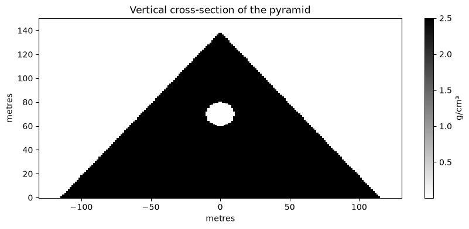
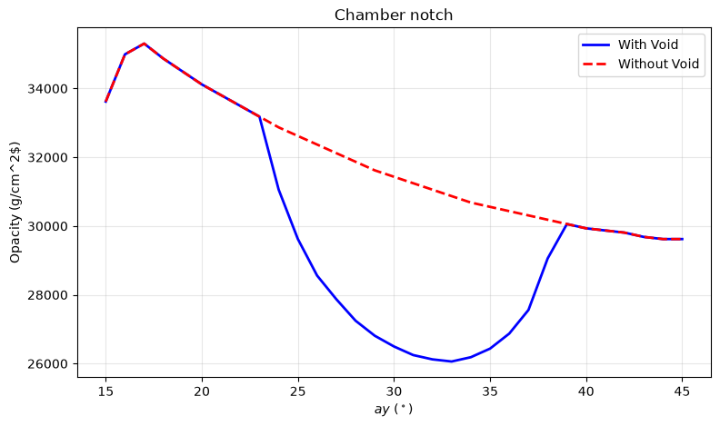

# Weekly log

---

## Week 3 — 5/10/2026-11/10/2026

**What I did**

I fixed the surviving flux against limestone graph to have only one curve of angle 0 degree instead of 4 from different angles.
I finished the vertical slice of the pyramid colourbar and the graph of the chamber notch.

**What I found**

**What went wrong / what I don't understand**

I plotted the vertical slice with x as 230/2 which resulted in a rectangular plot, not realising that it would not be the centre of the pyramid. I had to change x to 0 as the origin was the centre of the pyramid.

**Next week I plan to**

Code the opacity map.
Look through my past graphs for mistakes.

**Hours spent: 2** ___
