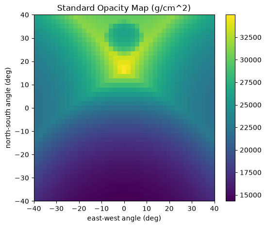
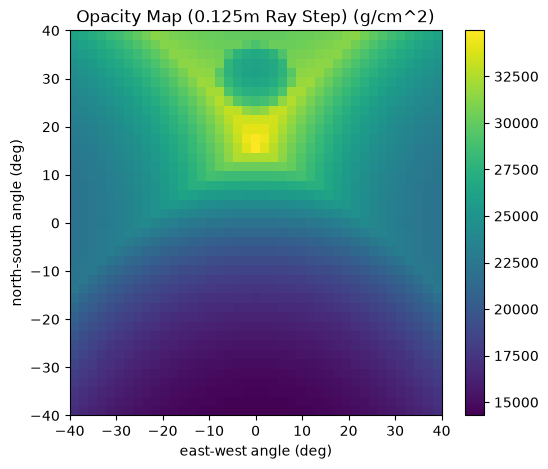

# Weekly log

---

## Week 4 — 12/10/2026-18/10/2026

**What I did**

I coded the function opacity_map by using rays from multiple angle directions.
Using this function, I plotted the opacity map against the north-south angle and east-west angle
for the target with and without the void, showing where the void is. 

**What I found**

The void is present roughly at 25 to 35 degrees on the north-south axis 
and -10 to 10 degrees on the east-west axis. 

Decreasing the ray step to 0.125 did not increase the resolution by much.

**What went wrong / what I don't understand**

I forgot to do multiple loops when producing the opacity map function.
I was also confused with how to use the field degree parameter.

**Next week I plan to**

Start working on notebook 3.
I will implement the expected count function in student_analysis.py.
I will produce the 30 day expected muon count map for the targets with and without the void.

**Hours spent: 5** ___
