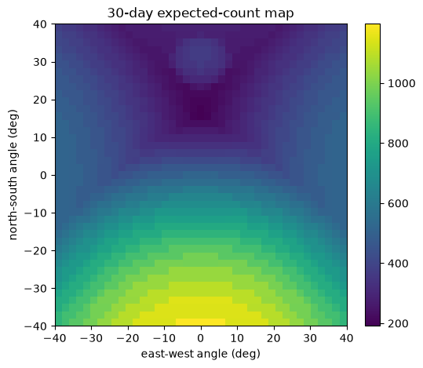
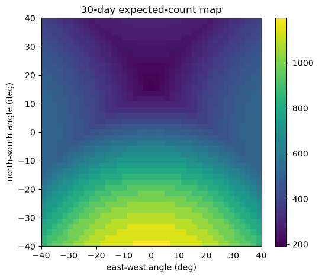

# Weekly log

---

## Week 5 — 19/10/2026-25/10/2026

**What I did**

I implemented the expected count function in student_analysis.py.
I plotted the 30 day expected muon count map for the targets with and without the void.

**What I found**

By comparing both graphs I was able to detect the presence of the void around 25 to 40 degrees on the north-south angle axis and -10 to 10 degrees on the east-west angle axis.

**What went wrong / what I don't understand**

I didn't know how to calculate the pixel solid angle until I reread muography.py and found the function.
I'm unsure if the field angle given in project_config is the half field or the full field angle.

**Next week I plan to**

Use mg.poisson_counts to plot the 1-day and 30-day observed count maps. 
Plot the significance maps for 1 day and 30 days. 

**Hours spent: *4* ___
