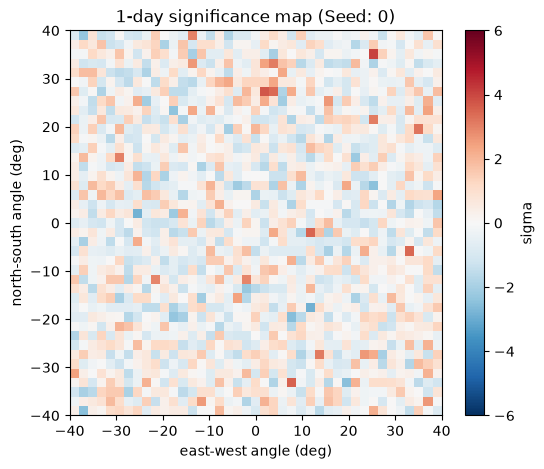
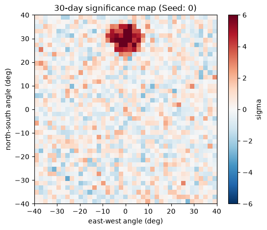
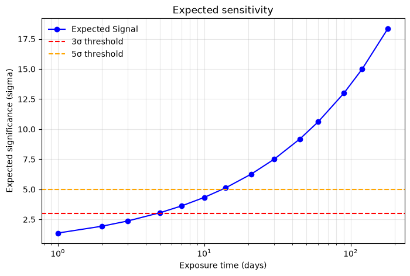

# Weekly log

---

## Week 6 — 26/10/2026-1/11/2026

**What I did**

I finishes the 1-day and 30-day significance map. 
I calculated the expected sensitivity for 5 sigma and 3 sigma.
I did the same for the target with void with the poisson noise.

**What I found**

By 30-days, the chamber can be clearly seen.

The time taken to reach 5 sigma is around 11 days.
The time taken to reach 3 sigma is around 4 days.

**What went wrong / what I don't understand**
-

**Next week I plan to**
I finish notebook 5. I will work on study B and study C to study the affects of changing the height of the chamber and the position of the detector of the expected significance.

**Hours spent: *8* ___
