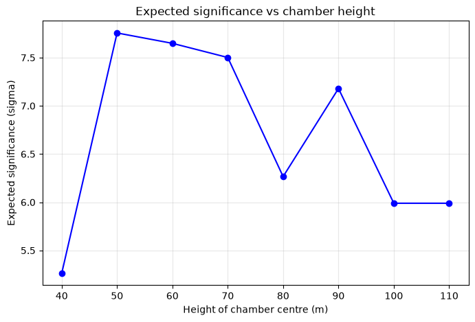
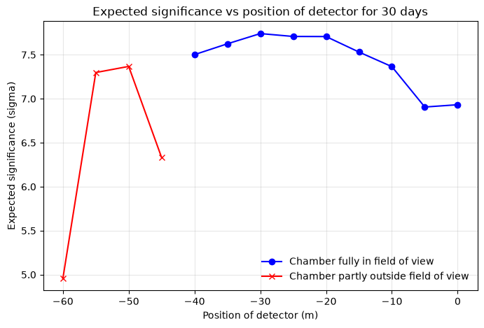

# Weekly log

---

## Week 7 — 2/11/2026-8/11/2026

**What I did**

I finished notebook 5. I worked on study B and study C.

**What I found**

In general, increased depth, decreases the expected significance.

As the position of the detector moved up,

**What went wrong / what I don't understand**
I found an odd decrement in the graph at 80m. I believe it is due to the detectors view.
I'm doubtful that if the position of the dectector increases, that the expected significance should drop. 

**Next week I plan to**
Look into the mistakes on the graphs.
Write the overleaf.
Write the script for the video presentation.

**Hours spent: *5* ___
